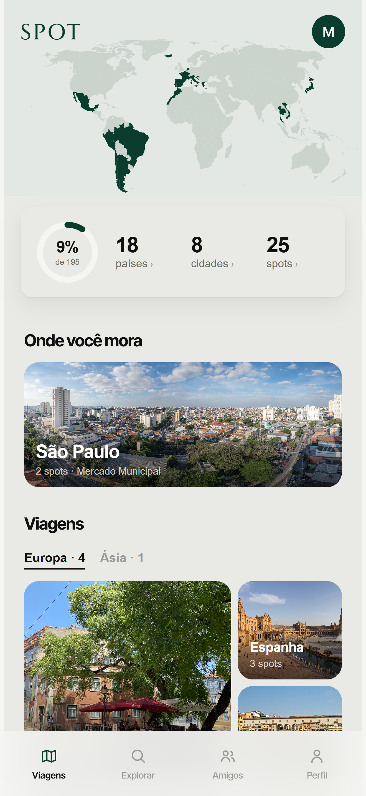
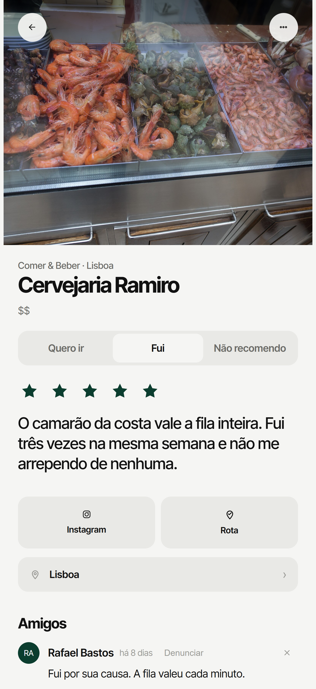
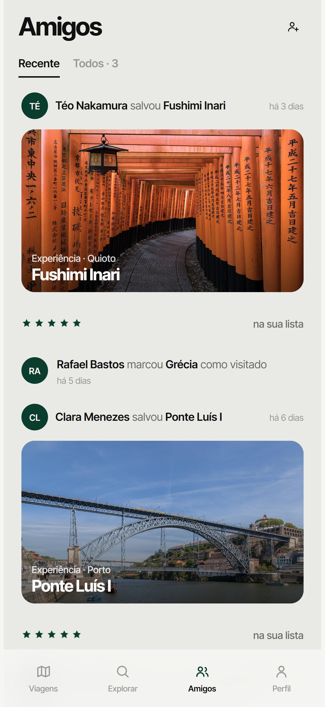
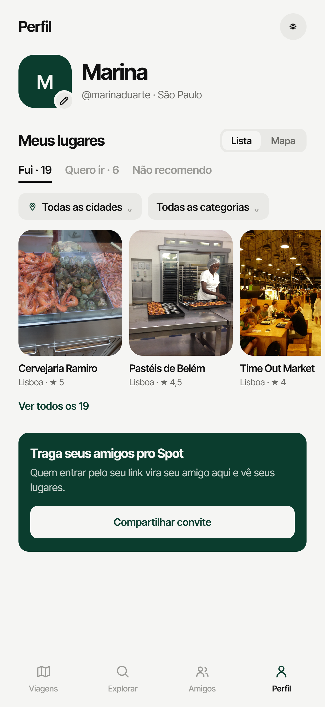

# Spot

**Seus lugares, sua voz.** O Spot é um app pra guardar os lugares onde você foi e quer ir, do bar do bairro à viagem do ano, e descobrir onde ir pelo que seus amigos indicam.

- **App Store:** [Spot: Been There](https://apps.apple.com/br/app/spot-seus-lugares/id6814856044) (no ar desde 01/10/2026, Brasil, Portugal, EUA e Suíça)
- **Site:** [meuspot.app/sobre](https://meuspot.app/sobre)

<p>
  
  
  
  
</p>

## O problema

Recomendação de lugar vive espalhada: print no celular, mensagem perdida no grupo, lista no bloco de notas, estrela no Google Maps sem contexto. Quando chega a hora de escolher onde jantar ou montar uma viagem, a dica do amigo que conhece o lugar é justamente a que ninguém acha. E as avaliações públicas são de estranhos.

O Spot junta as duas pontas: o seu diário de lugares (onde foi, o que achou, onde quer ir) e o dos seus amigos, que é a recomendação em que você confia.

## O que ele faz

- **Salvar um spot** (restaurante, hotel, experiência) em Fui ou Quero ir, com nota de meia em meia estrela e a dica que importa ("peça o camarão").
- **Amigos:** pedido de amizade, feed do que eles salvaram, comentários em cada spot e a ficha do lugar mostrando quem foi e o que disse.
- **Explorar no mapa:** os spots dos amigos como pinos de foto, as sugestões do Google como pontos discretos, busca por rua, bairro, cidade ou país.
- **Planejar com amigos:** escolher vários destinos, ver tudo que os amigos indicam lá e montar a própria viagem.
- **Lista compartilhada:** mandar "meus spots de Chicago" como uma página bonita; quem recebe instala o app e já encontra a lista dentro.
- **Importar notas com IA:** colar uma lista bagunçada do WhatsApp ou do bloco de notas e o app separa os lugares (Claude Haiku).
- **Hotspots:** um robô semanal lê o que chefs e criadores de conteúdo indicam, cruza as vozes e monta a lista dos lugares mais citados de cada cidade.
- **Seu mapa:** países e cidades por onde você passou, e a cidade onde mora em destaque.
- **Português e inglês.**

## Como foi construído: com IA, do zero à App Store

O Spot foi construído com o **Claude Code** como par de programação, por quem não é desenvolvedor de formação. O primeiro commit é de 18/06/2026; o app foi aprovado na App Store em 01/10/2026 e teve mais quatro versões aprovadas na primeira quinzena de outubro.

**A divisão de trabalho:**

| Do lado humano | Do lado da IA |
|---|---|
| O que construir e por quê: o problema, as prioridades, o que fica de fora | Escrever o código: telas, servidor, banco, app nativo |
| Decisões de produto e de design, tela por tela (várias direções foram recusadas antes da atual) | Propor caminhos e mostrar as opções antes de decidir |
| Testar no iPhone, com gente de verdade usando | Testes automáticos e testes no navegador antes de cada publicação |
| Contas, chaves, pagamentos e tudo que exige um dono | Auditorias de segurança e de custo, com as correções |

**Na prática:**

- **Produto antes de código.** Mudança grande começa como conversa ("não execute ainda"); só vira código quando a decisão está fechada. As decisões ficam registradas em `CLAUDE.md`, que é a memória do projeto entre uma sessão e outra.
- **Design com IA também.** As telas foram desenhadas no Claude Design e implementadas a partir desses desenhos, com um sistema de design próprio (um acento só, sem bordas nem sombras, uma família tipográfica).
- **Verificar antes de afirmar.** Nada vai ao ar sem passar nos testes; as revisões de segurança (como a de 16/10) foram feitas como pen test, procurando o furo antes de alguém achar.
- **IA dentro do produto, não só no desenvolvimento.** O Claude Haiku separa os lugares de uma lista colada do WhatsApp e lê as fontes do robô dos Hotspots, sempre pelo servidor e com teto de uso.

**Em números:** mais de 600 commits, 36 migrações de banco, mais de 290 testes automáticos, 5 versões aprovadas na App Store.

## Como é feito

| Parte | Tecnologia |
|---|---|
| App de iPhone | Expo / React Native (abas nativas em `mobile/`) com as telas web por dentro |
| Telas | `index.html`: HTML, CSS e JavaScript sem framework e sem etapa de build |
| Servidor | Cloudflare Pages Functions (`functions/`): Google Places, fotos, notificações, IA e o robô dos Hotspots, sempre com as chaves no servidor e cache compartilhado em KV |
| Banco e login | Supabase (Postgres com RLS em todas as tabelas, login com Google, Apple e e-mail). Migrações em `migrations/` |
| IA | Claude Haiku, com saída estruturada, para importar notas e ler as fontes dos Hotspots |
| Deploy | Cada push no `main` vai pro ar no Cloudflare |

## Pastas

```
index.html          o app (telas)
functions/api/      o servidor: uma rota por arquivo
migrations/         o banco, migração por migração (001 a 036)
mobile/             a casca nativa do iPhone (Expo)
i18n/               a tradução para inglês
tests/              testes automáticos (node --test)
ferramentas/        scripts de apoio: testes no navegador, ícones, capturas da loja
```

## Testes

```bash
node --test
```

Mais de 290 testes das rotas do servidor e da lógica do app. Antes de cada publicação rodam também dois testes no navegador, contra um banco falso que imita as regras de acesso do Supabase:

- `node ferramentas/pente-fino.mjs`: abre todas as telas e falha em qualquer erro.
- `node ferramentas/jornadas.mjs`: duas contas usando o app ao mesmo tempo (pedido de amizade, aceite, comentário, Planejar, bloqueio, troca de conta).

## Segurança e privacidade

- Nenhuma chave paga fica no app: Google, Unsplash e Anthropic vivem no servidor, com teto de uso por pessoa e por mês.
- Quem protege os dados é o RLS do banco: o que é privado (Quero ir de viagem "Só eu vejo", e-mail, bloqueios) não chega a quem não deve, mesmo chamando a API direto.
- Fizemos uma revisão de segurança em 16/10/2026 e fechamos o que ela achou (XSS armazenado, busca de perfis, páginas antigas expostas).

---

Feito por Lucas Patriarcha.
